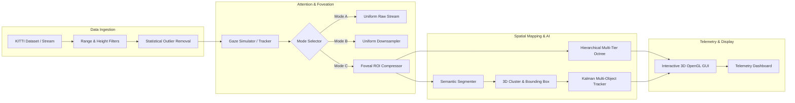

# 👁️ FoveaLiDAR: Adaptive Variable-Resolution 2.5D LiDAR Mapping for Dynamic Autonomous Perception

[](https://www.python.org/)
[](#-system-architecture--progress)
[-success)](#-testing--validation)
[](LICENSE)
[](#-interactive-gui--visualization)

> **FoveaLiDAR** tackles the massive bandwidth, compute, and memory bottlenecks in 3D autonomous perception by emulating **human biological eye-gaze (foveation)**. Instead of uniformly processing over 100,000+ points per frame across a 100m+ perimeter, FoveaLiDAR dynamically allocates high-resolution voxel structures to critical Regions of Interest (ROI) while aggressively downsampling peripheral zones — boosting processing throughput up to **30+ FPS** while maintaining high spatial fidelity.

---

## 📑 Table of Contents
- [Key Innovations](#-key-innovations)
- [3-Way Processing Modes (A vs B vs C)](#-3-way-processing-modes-a-vs-b-vs-c)
- [System Architecture & Modules](#-system-architecture--modules)
- [Project Directory Structure](#-project-directory-structure)
- [Quick Start & Installation](#-quick-start--installation)
- [Interactive GUI & Control Center](#-interactive-gui--control-center)
- [Testing & Validation](#-testing--validation)
- [Roadmap & Next Steps](#-roadmap--next-steps)
- [License & Acknowledgments](#-license--acknowledgments)

---

## ⚡ Key Innovations

1. **Human Eye-Gaze Emulation (Foveal ROI)**
   - Prioritizes critical sectors (forward drive path, high-velocity obstacles, intersection focus) with a concentrated, high-density inner fovea.
   - Peripheral compression achieves **90–98% data reduction** outside active zones without losing situational awareness.
2. **Hierarchical Multi-Tier Octree 2.5D/3D Mapping**
   - Implements dynamic Level of Detail (LOD) voxel structures (Fine, Medium, Coarse).
   - Eliminates redundant point updates, minimizing RAM consumption and cache misses during real-time exploration.
3. **Edge-Optimized Semantic AI Segmentation**
   - Real-time classification distinguishing **Ground (drivable)**, **Obstacles (vehicles, pedestrians)**, and **Vegetation/Environment**.
   - Zero heavyweight GPU requirements — designed to operate on edge compute embedded systems.
4. **3D Detection, Bounding Boxes & Object Tracking**
   - Spatial clustering with 3D oriented bounding box extraction.
   - Kalman filter motion prediction coupled with Hungarian association algorithm for consistent target identification and trajectory forecasting.
5. **Real-time Dual-Tab Telemetry Dashboard**
   - Hardware-accelerated OpenGL 3D viewer featuring interactive gaze reticles, point-cloud stream inspection, and comparative Mode A/B/C performance metrics.

---

## 🔬 3-Way Processing Modes (A vs B vs C)

| Metric / Mode | Mode A (Raw Baseline) | Mode B (Uniform Downsampled) | Mode C (Adaptive Foveated) |
| :--- | :---: | :---: | :---: |
| **Strategy** | Full point ingestion | Static grid voxelization | Focus-aware gaze ROI + LOD |
| **Data Throughput** | ~112,000 pts / frame | Uniformly reduced | Dynamically concentrated |
| **Periphery Compression** | 0% | Fixed ~50% | **90% – 98%** |
| **ROI Detail** | High | Degraded uniformly | **Maximum (Retained full resolution)** |
| **Framerate Cadence** | ~12 – 15 FPS | ~20 – 25 FPS | **30+ FPS (Real-time capability)** |
| **Memory Footprint** | Heavy linear growth | Moderate | **Optimal bounded footprint** |

---

## 🏗️ System Architecture & Modules



---

## 📂 Project Directory Structure

```text
FoveaLiDAR/
├── config/                     # Application configurations & camera/LiDAR settings
├── fovealidar/                 # Core Python package
│   ├── core/                   # Dataclasses, base types, config schemas, diagnostics
│   ├── data/                   # KITTI loader (raw, odometry, OXTS IMU/GPS) & factory
│   ├── preprocessing/          # 6-stage point cloud filter pipeline
│   ├── foveation/              # Gaze simulator, ROI boundary calculator, adaptive compression
│   ├── mapping/                # Uniform & dynamic multi-tier hierarchical octree maps
│   ├── perception/             # Semantic segmentation, 3D clustering, and object tracker
│   ├── gui/                    # Dual-view PySide6/OpenGL desktop visualization app
│   └── visualization/          # Offline rendering, point cloud colorizers, and video utils
├── tests/                      # Full pytest test suite (Phases 0 to 8: 86 tests)
├── pyproject.toml              # Modern PEP 621 build & dependency configuration
├── requirements.txt            # Package dependencies
├── run_app.bat                 # Unified interactive control center for Windows
├── setup.bat                   # One-click virtual environment & dependency setup
└── main.py                     # Desktop GUI entrypoint
```

---

## 🚀 Quick Start & Installation

### Prerequisites
- **Operating System:** Windows 10/11, Ubuntu 20.04+, or macOS
- **Python:** 3.10, 3.11, or 3.12 (Python 3.11 recommended)

### 1. Clone the Repository
```bash
git clone https://github.com/<your-username>/fovealidar.git
cd fovealidar
```

### 2. Environment Setup

#### On Windows (Automated):
Run the provided setup script:
```cmd
setup.bat
```

#### On Linux / macOS (Manual):
```bash
# Create and activate virtual environment
python3 -m venv venv
source venv/bin/activate

# Upgrade pip and install package with development tools
pip install --upgrade pip
pip install -r requirements.txt
pip install -e .
```

---

## 🖥️ Interactive GUI & Control Center

On Windows, launch the comprehensive control center by running:
```cmd
run_app.bat
```
This utility provides quick options to:
- **Run Unit & Integration Test Suites** (by phase or full suite).
- **Launch GUI Dashboard:** Full dual-tab visualization.
  - **Tab 1 (3D Foveation View):** Interactive 3D OpenGL viewport displaying colorized point clouds, active gaze reticles, and semantic tags.
  - **Tab 2 (Hierarchical Map View):** Live octree node inspection, memory profiling, and real-time Mode A / B / C comparison.
- **Process Sequence Data:** Batch process raw KITTI frames with foveated compression.

To directly start the GUI via Python:
```bash
python main.py
```

---

## 🧪 Testing & Validation

FoveaLiDAR maintains strict validation with **100% test pass rate** across all implemented modules.

Run the test suite:
```bash
# Run all 86 unit and integration tests
pytest

# Run tests with execution timings
pytest -v --durations=10

# Test specific phase (e.g., Phase 6 Foveal Controller)
pytest tests/test_phase6_*.py
```

### Phase Verification Summary:
- **Phase 0 (Foundation):** `6/6 passed` — Core types, config loader, hardware diagnostics.
- **Phase 1 (KITTI Engine):** `13/13 passed` — Binary format readers, odometry, and calibration.
- **Phase 2 (Preprocessing):** `10/10 passed` — Range, height, voxel, and statistical outlier filters.
- **Phase 3 (Foveated ROI):** `22/22 passed` — Gaze simulator and adaptive compression ratios.
- **Phase 4 (Base Mapping):** `6/6 passed` — Base uniform 2.5D voxel map.
- **Phase 5 (Multi-Tier Octree):** `5/5 passed` — Adaptive dynamic LOD hierarchy.
- **Phase 6 (Foveal Controller):** `22/22 passed` — Automated switching & arbitration of Modes A/B/C.
- **Phase 7 & 8 (Perception):** `2/2 passed` — Semantic segmentation & multi-target tracking.

---

## 🗺️ Roadmap & Next Steps

- [x] **Phase 0–6:** Foundation, KITTI ingestion, pre-filters, foveation logic, and multi-tier mapping.
- [x] **Phase 7:** Edge-optimized 3-class semantic AI point tagging.
- [x] **Phase 8:** DBSCAN 3D clustering, bounding box extraction, and Kalman-based tracking.
- [ ] **Phase 9:** Compute-aware dynamic scheduling (dynamic FPS throttle & power management).
- [ ] **Phase 10:** Comprehensive automated benchmarking suite & publication-ready video export.

---

## 📄 License & Acknowledgments

This project is licensed under the **MIT License** — see the [LICENSE](LICENSE) file for details.

- **KITTI Vision Benchmark Suite:** Geiger et al. for providing standard autonomous driving point-cloud sequences.
- Built using [Open3D](http://www.open3d.org/) and [PySide6](https://wiki.qt.io/Qt_for_Python).
